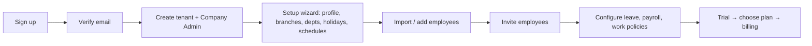
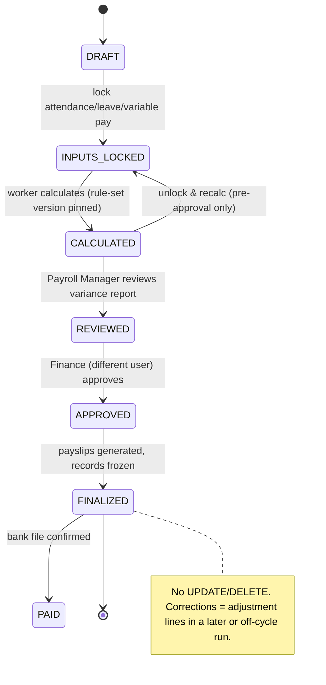

# 01 — Requirements & Business Workflows

Status: **Draft for review** · Phase 1 · Owner: CTO

> **Scope update:** the product is **worldwide**. Global requirements (legal entities, country payroll packs, data residency, jurisdiction-aware monitoring, localization, multi-currency billing) are in [06-global-architecture.md](06-global-architecture.md), which takes precedence over this document.

---

## 1. Product definition

A multi-tenant HRMS SaaS for SMEs worldwide (10–1,000 employees per tenant, often across several countries) that covers the full employee lifecycle plus a **transparent** remote-work module: work sessions, tasks, daily reports, timesheets and an optional, disclosed screenshot agent.

### 1.1 Goals (measurable)

| # | Goal | Measure |
|---|------|---------|
| G1 | One system of record for people data | 100% of employee, attendance, leave and payroll data lives in the platform |
| G2 | Payroll that is correct and explainable | Every payslip line traceable to a rule-set version and input; zero edits to finalized runs |
| G3 | Remote work visibility without surveillance | Work time comes from server-verified events; monitoring is opt-in per policy, disclosed, and audited |
| G4 | Self-onboarding SaaS | A company can sign up, configure, and run its first payroll without vendor help |
| G5 | Tenant isolation | Zero cross-tenant reads in automated security tests (gate on every release) |

### 1.2 Non-goals for v1

- Native mobile apps (responsive web first; PWA later).
- Native statutory payroll in every country (only the selected launch countries get native packs; others use configurable or export mode — see 06 §2.3).
- Biometric device integration (interface defined; vendor adapters later).
- Productivity "scores" derived from activity counts (explicitly excluded by design).
- Keystroke, clipboard, webcam, microphone, or covert capture — **never**.

---

## 2. Actors & default roles

| Role | Scope | Notes |
|---|---|---|
| Super Admin | Platform | Vendor staff. Cannot read tenant HR data by default; break-glass access is time-boxed, reason-logged and visible to the tenant. |
| Company Admin | Tenant | Owns configuration, roles, billing. |
| HR Manager | Tenant | Full HR ops; payroll **view** only unless granted. |
| HR Executive | Tenant / branch | Day-to-day HR data entry. |
| Payroll Manager | Tenant | Runs payroll; approval requires a second person (maker-checker). |
| Finance Manager | Tenant | Approves payroll, bank files, reimbursements. |
| Department Manager | Department subtree | Approvals for own department. |
| Team Leader | Direct/indirect reports | Approvals for own team. |
| Recruiter | Requisitions assigned | No access to employee records. |
| Employee | Self | Self-service. |

### 2.1 Permission model

- Permission = `module.resource.action` + **data scope** (`own`, `team`, `department`, `branch`, `company`).
- Roles are tenant-customizable bundles of (permission, scope). Users can hold several roles.
- **Sensitive permission groups** are never included implicitly by any "manager" role and must be granted explicitly:
  - Payroll: `payroll.salary.view`, `payroll.run.*`, `payroll.bank.view`
  - Monitoring: `view_team_work_status`, `view_own_screenshots`, `view_team_screenshots`, `download_screenshots`, `manage_monitoring_policy`, `view_activity_reports`
  - Work management: `approve_timesheets`, `approve_work_reports`, `manage_work_sessions`
  - Audit: `audit.log.view`; Billing: `subscription.manage`; Exports: `reports.export`
- Granting a sensitive permission is itself audited and (configurable) requires Company Admin approval.
- Team scope is computed from the reporting hierarchy (closure table), not from the frontend.

---

## 3. Functional requirements (by module)

IDs are referenced from the API spec and test plan. **M** = MVP, **L** = later sprint in the same release, **F** = future.

### A. Company & organization
- ORG-01 M Tenant sign-up, email verification, company profile, timezone, currency, country, fiscal year.
- ORG-02 M Branches, departments (tree), designations, teams, reporting hierarchy, org chart.
- ORG-03 M Working calendars, holiday lists per branch, work schedules (fixed/flexible/shift).
- ORG-04 L Company policies (versioned documents with employee acknowledgement tracking).

### B. Employee management
- EMP-01 M Profile: personal, contact, employment, bank (encrypted), emergency contacts, documents.
- EMP-02 M Configurable employee code format; status lifecycle (`PREBOARDING → PROBATION → ACTIVE → NOTICE → EXITED`).
- EMP-03 M Employment history is effective-dated (designation, department, manager, location, salary).
- EMP-04 M Directory with search/filters respecting data scope; field-level masking (e.g., PAN, bank).
- EMP-05 L Bulk import (CSV/XLSX) via background job with row-level validation report; bulk export.

### C. Attendance
- ATT-01 M Clock-in/out (web; geo/IP capture optional and disclosed), work location selection.
- ATT-02 M Shifts, flexible shifts, grace periods, late/early flags, breaks, overtime rules.
- ATT-03 M Regularization (correction) requests with approval; daily attendance status computed by worker.
- ATT-04 L Reports; F biometric adapters.

### D. Leave
- LEV-01 M Leave types (system + custom), policies (accrual, carry-forward, caps, sandwich rule, gender/tenure eligibility), effective-dated.
- LEV-02 M Ledger-based balances (every credit/debit is a row; balance = sum) — no mutable "balance" field.
- LEV-03 M Applications, half-day, multi-level approval chains, cancellation, holiday-aware day counting.
- LEV-04 L Encashment (feeds payroll), reports.

### E. Payroll (country-pluggable; India is one pack)
- PAY-01 M Salary components (earning/deduction/employer contribution; fixed/formula/percentage), structures, effective-dated employee salary assignments.
- PAY-02 M **Statutory rule packs per country** (example for the India pack: PF, ESI, PT by state, TDS old/new regime, LWF, gratuity; UK pack: PAYE, NI, pension auto-enrolment; etc.) stored as effective-dated, versioned configuration. No rate in code.
- PAY-03 M Payroll run lifecycle: `DRAFT → INPUTS_LOCKED → CALCULATED → REVIEWED → APPROVED → FINALIZED → PAID`. Maker-checker between REVIEWED and APPROVED.
- PAY-04 M Finalized runs and payslips are immutable (DB trigger + application guard). Corrections only through arrears/adjustment in a later run or an off-cycle run.
- PAY-05 M Payslips (PDF via worker), bank transfer file, payroll register, reconciliation vs previous month (variance report).
- PAY-06 L Salary revisions with arrears, LOP from attendance/leave, F&F settlement, Form 16 / 24Q data exports.
- All money: `DECIMAL(19,4)` with an ISO 4217 currency code; rates `DECIMAL(9,6)`; computed with `decimal.js`; rounding per currency minor units and per component rule.

### F. Recruitment
- REC-01 L Requisitions with approval, job posts, public careers page per tenant (subdomain/path).
- REC-02 L Candidates, resume upload, parsing (text extraction + field heuristics; pluggable external parser), dedupe.
- REC-03 L Pipeline stages (configurable), interviews, scorecards, hiring approval, offer letters (templated PDF).
- REC-04 L Candidate → employee conversion (feeds onboarding).

### G. Onboarding
- ONB-01 L Pre-boarding portal (limited-access account), digital joining forms, document collection & verification.
- ONB-02 L Checklist templates (HR, IT, manager tasks), asset allocation, welcome email, probation tracking.

### H. Performance
- PER-01 L Cycles, goals/OKRs/KPIs with weights, self + manager assessment, 360 feedback (anonymity threshold ≥ 3), calibration, ratings, development plans, appraisal → salary revision hand-off.

### I. Employee self-service
- ESS-01 M Profile (change requests for sensitive fields), attendance, leave, payslips, tax declarations, documents, announcements, helpdesk tickets, work status, daily reports, own screenshots, monitoring status.

### J. Work Status & Remote Workforce (core differentiator)
- WFH-01 M Work locations: Office, WFH, Hybrid, Remote, Client site, Travel, custom.
- WFH-02 M Work policies per tenant/branch/department/employee-group: WFH eligibility, approval requirement, allowed hours, break policy, idle threshold, timesheet requirement, heartbeat timeout.
- WFH-03 M WFH requests (single day / range / recurring pattern) with approval.
- WFH-04 M Work sessions (web or desktop): start, break, resume, end; event-sourced; server time authoritative (see §5).
- WFH-05 M Tasks & projects integrated into the session; time entries per task.
- WFH-06 M Daily work report auto-generated; employee edits notes and submits; manager approves/rejects/requests changes.
- WFH-07 M Timesheets (weekly) aggregated from time entries and sessions; approval.
- WFH-08 L Desktop agent: device pairing, disclosed periodic screenshots, exclusions, idle detection, optional app-category metadata.
- WFH-09 L Screenshot review (employee own, authorized managers), disputes, privacy incident reports, retention deletion.
- WFH-10 M Manager live dashboard; HR remote-work dashboard.
- WFH-11 M Work corrections (missing checkout, idle disputes, disconnected periods) with approval and full audit.

### K. SaaS administration
- SAS-01 L Plans (per-employee-per-month tiers + module add-ons such as "Monitoring"), trials, subscriptions, invoices (GST), payment gateway, dunning, usage metering (active employees, storage), suspension/reactivation, tenant data export and deletion.

### L. Cross-cutting
- XC-01 Notifications (in-app + email; templates per tenant; no sensitive content or screenshots in email).
- XC-02 Audit log (append-only) for all writes to HR, payroll, permission and monitoring data, plus reads of sensitive data.
- XC-03 Reports & exports (async, signed download links, watermarking with requester identity).
- XC-04 i18n-ready UI strings; dates/time in tenant/employee timezone; UTC in storage.

---

## 4. Non-functional requirements

| Area | Target (v1) |
|---|---|
| Availability | 99.9% monthly for API/web; desktop agent tolerates 72 h offline (queues metadata, not working-time credit) |
| Latency | p95 < 300 ms for reads, < 500 ms for writes at target load |
| Load (design point) | 500 tenants, 50,000 employees, 30% concurrent in peak hour; 15,000 active desktop agents at 10-min interval ≈ 25 screenshot uploads/s, heartbeats ≈ 250 req/s |
| Payroll | 5,000-employee run calculated < 5 min (worker) |
| RPO / RTO | 5 min / 4 h |
| Security | OWASP ASVS L2 baseline; tenant isolation tests gate every release |
| Privacy | GDPR/UK GDPR, CCPA/CPRA, DPDP (India), LGPD, PIPEDA and similar regimes supported through configurable processes; data minimization; retention enforced automatically; regional data residency |
| Localization | i18n UI with RTL support, locale formats, multi-currency, IANA time zones |
| Accessibility | WCAG 2.2 AA for web app |
| Browsers | Last 2 versions of Chrome, Edge, Firefox, Safari |
| Desktop OS | Windows 10/11, macOS 13+; Linux X11 best-effort, Wayland limited (portal prompt per session) |

---

## 5. Key business workflows

### 5.1 Tenant onboarding


### 5.2 Leave approval
```mermaid
sequenceDiagram
  participant E as Employee
  participant API
  participant M as Manager (L1)
  participant H as HR (L2, optional)
  E->>API: Apply (type, dates, half-day)
  API->>API: Validate policy, balance (ledger), overlaps, holidays
  API-->>M: Notify
  M->>API: Approve / Reject
  alt Chain has L2
    API-->>H: Notify
    H->>API: Approve
  end
  API->>API: Post ledger debit; mark attendance days
  API-->>E: Notify outcome
```

### 5.3 Payroll run (maker–checker, immutable finalization)


### 5.4 WFH day — end-to-end (the core flow)
```mermaid
sequenceDiagram
  participant E as Employee (web)
  participant D as Desktop agent (optional)
  participant API
  participant W as Worker
  participant M as Manager
  E->>API: Request WFH for date
  M->>API: Approve (or auto-approve per policy)
  E->>API: Check-in: location=WFH
  API->>API: Check eligibility/approval, schedule window, no active session
  API-->>E: Show monitoring notice if policy requires → employee acknowledges (versioned)
  API->>API: session.START (server time)
  D->>API: Agent attaches to session (device token); shows tray "Monitoring ON"
  loop every 60s
    E->>API: heartbeat (web tab) / D->>API: heartbeat + idle state
  end
  loop every N min (policy), only while ACTIVE and not idle/locked/excluded
    D->>API: request upload slot → presigned PUT → upload → confirm
    API->>W: process screenshot (validate, thumbnail, tag retention)
  end
  E->>API: Task updates / time entries
  E->>API: BREAK_START → agent pauses capture
  E->>API: BREAK_END → agent resumes
  E->>API: END session
  W->>API: Build daily work report draft
  E->>API: Add notes, submit report
  M->>API: Review (screenshots only if permitted) → approve / request changes
  M->>API: Approve weekly timesheet
```

### 5.5 Work-time verification rules (server side)
1. Only server-received events count; each event stores `server_ts` (authoritative) and `client_ts` (informational).
2. A session is "verified active" between events while heartbeats arrive within `heartbeat_timeout` (policy, default 3 min).
3. Heartbeat gap > timeout → a **`DISCONNECTED` segment** is opened at the last heartbeat; it is **not counted** as work. A heartbeat after the gap closes it (`RECONNECTED`).
4. Idle (OS idle ≥ policy threshold, reported by agent) → `IDLE` segment; counted or not per disclosed policy (default: not counted beyond threshold, employee can annotate).
5. Missing check-out: scheduler auto-closes at the last verified heartbeat (or schedule end, whichever is earlier) with status `AUTO_CLOSED` and flags for review.
6. Duplicate check-in: one active session per employee enforced by a locked `employee_active_session` row; second device attaches to the same session instead of creating one.
7. Browser closed / device shutdown → same as rule 3. Session can be resumed the same work day within `resume_window` (policy).
8. Manual corrections create `work_corrections` rows (requested → approved/rejected); original events are never altered; derived totals are recomputed.

### 5.6 Screenshot dispute & privacy incident
Employee flags a screenshot → image is immediately hidden from managers (`UNDER_DISPUTE`) → HR / privacy officer reviews → outcome: restored, deleted (with audit reason), or session time corrected. Privacy incidents (e.g., personal content captured) follow the same path with deletion as the default resolution and incident logging.

### 5.7 Recruitment → onboarding → employee
Requisition approved → job published → candidates apply → pipeline/interviews/scorecards → hiring approval → offer (accepted) → pre-boarding account → forms/documents verified → employee record activated on joining date → probation tracking.

---

## 6. Assumptions (please confirm or correct — see open questions in README)

1. ~~India is the launch market.~~ **Answered: worldwide.** See 06.
2. Shared-database multi-tenancy is acceptable for SMEs (no single-tenant DB requirement at launch).
3. Desktop monitoring is offered only on **company-managed devices** in v1; BYOD gets work-session tracking without screenshots.
4. Pricing per active employee per month, with Monitoring as a paid add-on.
5. Hosting in regional cells (see 06 §3); which regions launch first is an open question.
