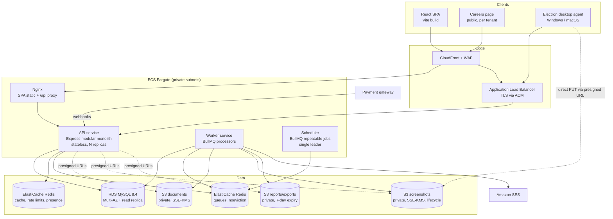
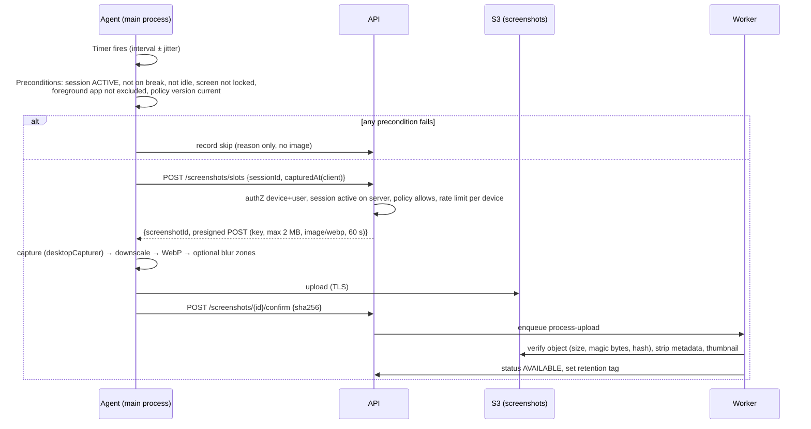

# 02 — Technology Stack & System Architecture

> **Scope update:** worldwide deployment uses regional cells, a country-pluggable payroll engine and i18n — see [06-global-architecture.md](06-global-architecture.md).

Covers: JavaScript stack, system architecture, multi-tenant design, WFH & monitoring architecture, Electron desktop architecture, security & privacy architecture.

---

## 1. JavaScript-only technology stack

Versions are the planned baselines; exact versions are pinned in `package-lock.json` during Sprint 1.

| Layer | Choice | Why |
|---|---|---|
| Runtime | **Node.js 24 LTS** | Current active LTS |
| Language | JavaScript ES2024, ES Modules, **JSDoc** + `// @ts-check` for editor type hints (no `.ts` files) | Mandated JS-only; JSDoc keeps IDE safety |
| Monorepo | npm workspaces | No extra tooling needed |
| Frontend | React 19, Vite 7, React Router 7 (library mode), TanStack Query 5, React Hook Form + Zod | Server-state caching, form validation sharing schemas with backend |
| UI | Tailwind CSS 4, shadcn/ui (`"tsx": false` in `components.json` → emits `.jsx`), Radix primitives, Lucide React, Recharts | Required; accessible primitives |
| Backend | Express 5, Zod (runtime validation), pino (logs), helmet, cors, express-rate-limit + rate-limit-redis | Express 5 handles async errors natively |
| ORM | Prisma ORM with the JavaScript client generator (`prisma-client-js`) | Required. Generated client is build output, not authored source. Version pinned after a Sprint 1 spike confirms JS output (see risk R3). |
| Database | **MySQL 8.4 LTS** (Amazon RDS) | MySQL 8.0 reached end-of-life in April 2026; 8.4 is the supported MySQL 8 line |
| Cache / queues | Redis 7 (ElastiCache, `maxmemory-policy noeviction` for the queue cluster), BullMQ 5 | Required |
| Money | `decimal.js` (Prisma `Decimal`) | No floats for money |
| Auth | `argon2` (Argon2id), `jose` (JWT), `otplib` (TOTP MFA) | |
| API docs | OpenAPI 3.1 generated from Zod via `@asteasolutions/zod-to-openapi`, served by `swagger-ui-express` at `/api/docs` | One schema source for validation + docs |
| Files | AWS SDK v3 (S3, presigned URLs), `sharp` (thumbnails, metadata strip), `file-type` (magic bytes), ClamAV (malware scan for documents) | |
| PDF | `pdfkit` in worker (payslips, offers) | No headless browser in API path |
| Desktop | Electron (current stable), `electron-builder`, `electron-updater`, `get-windows` (active window metadata, permission-gated) | |
| Testing | Jest, Supertest, React Testing Library, Playwright, k6, Testcontainers (MySQL/Redis for integration tests) | Required + real DB in integration tests |
| Lint/format | ESLint 9 flat config, `eslint-plugin-security`, Prettier; a lint rule forbids `.ts/.tsx` files | |
| Infra | Docker, Nginx, AWS (ECS Fargate, ALB, RDS, ElastiCache, S3, CloudFront, KMS, Secrets Manager, SES, CloudWatch), Terraform in `infrastructure/aws` | IaC, reviewable |
| CI/CD | GitHub Actions; `npm audit`, OSV-Scanner, Gitleaks, Trivy (images), Semgrep | |

---

## 2. System architecture (modular monolith)



### 2.1 Backend module layout

Each module under `apps/backend/src/modules/<name>/` contains:

```
<name>.routes.js      # Express router, mounts validators + authorize()
<name>.controller.js  # HTTP ↔ service translation only
<name>.service.js     # business rules, transactions
<name>.repository.js  # Prisma access (tenant-scoped client only)
<name>.schemas.js     # Zod schemas (also exported to OpenAPI)
<name>.events.js      # domain events published to the internal bus / queues
<name>.policy.js      # authorization rules for the module's resources
__tests__/
```

Rules:
- Modules call each other through **service interfaces**, never each other's repositories.
- Cross-module side effects go through a domain-event outbox table (`outbox_events`) drained to BullMQ, so a DB commit and its job are consistent (no "job enqueued but transaction rolled back").
- Modules: Auth, Tenant, Company, Employee, Attendance, Shift, Leave, Payroll, Recruitment, Onboarding, Performance, WorkStatus, WorkSession, Screenshot, DesktopDevice, ApplicationActivity, Task, Project, Timesheet, Notification, Reports, Subscription, Audit (+ Platform for Super Admin).

### 2.2 Request pipeline

```
helmet → cors(allowlist) → request-id → pino-http → body limits →
rateLimit(redis) → authenticate(JWT) → resolveTenant(membership from DB/cache) →
tenantContext(AsyncLocalStorage) → validate(zod) → authorize(permission, scope) →
controller → service (tenant-scoped Prisma) → audit hook → error handler (problem+json)
```

### 2.3 Background jobs (BullMQ queues)

| Queue | Jobs | Notes |
|---|---|---|
| `payroll` | calculate-run, generate-payslips, bank-file | Concurrency 1 per tenant run (job id = run id) |
| `imports` | employee-import, attendance-import | Row-level results stored; idempotent on file hash |
| `screenshots` | process-upload, thumbnail, delete-object | Idempotent on screenshot id |
| `retention` | nightly sweep per tenant | Screenshots, activity records, exports, audit (per policy) |
| `reports` | generate-report, export | Output to S3 reports bucket |
| `notifications` | email, in-app fan-out | SES; template rendered server-side |
| `work-sessions` | auto-close stale sessions, build daily reports, attendance roll-up | Repeatable every minute / nightly |
| `billing` | usage snapshot, invoice, dunning | |

All jobs: deterministic job IDs for idempotency, exponential backoff, dead-letter queue with alerting, no in-memory critical state.

---

## 3. Multi-tenant design

### 3.1 Model: shared database, shared schema, `tenant_id` on every tenant-owned row

Reasoning: SMEs, many small tenants, single migration path, lowest cost. An enterprise tier can later get a dedicated database using the same code (the tenant registry stores a connection reference).

### 3.2 Enforcement layers (defense in depth)

1. **Identity → tenant resolution on the server.** JWT carries `sub` (user id) and `tid` (selected tenant), but the middleware re-checks the user's active membership in `tenant_memberships` (cached in Redis 60 s, invalidated on change). Any `tenantId` in a body, query or header is ignored.
2. **AsyncLocalStorage tenant context.** Set once per request/job. Repositories use `db()` which returns a Prisma client extended with a query extension that:
   - injects `tenantId` into `where` for all reads/updates/deletes on tenant models,
   - injects `tenantId` into `data` for creates and rejects a mismatching value,
   - **throws** if a tenant model is queried without context (fail closed).
   - Raw SQL is banned in repositories except through a reviewed helper that requires a tenant parameter.
3. **Composite keys at the database.** Every tenant table has `UNIQUE (tenant_id, id)`, and child tables reference parents with composite foreign keys `(tenant_id, parent_id) → parent(tenant_id, id)`. This makes it impossible at the DB level to link, e.g., a task to another tenant's employee.
4. **Index design.** All composite indexes lead with `tenant_id`.
5. **Storage.** S3 keys are prefixed `tenant/{tenantId}/…`; the API only signs keys it derives from DB records it has already loaded under tenant scope — never from client input.
6. **Cache keys.** `t:{tenantId}:…` prefix enforced by the cache helper.
7. **Jobs.** Every job payload carries `tenantId`; the worker sets the same context before running.
8. **Platform (Super Admin) access** uses a separate `platformDb()` client, only in the Platform module, every call audited. Access to tenant HR data requires a break-glass grant (tenant-visible, time-boxed).
9. **Tests.** A generated test suite iterates every tenant-scoped endpoint with tenant B's token against tenant A's resource IDs and expects `404`. A schema test asserts every Prisma model except the allowlisted global ones has `tenantId`.

### 3.3 Global (non-tenant) tables
`users`, `platform_admins`, `plans`, `plan_features`, `statutory_rule_packs` (platform-maintained defaults; tenants get copies/overrides), `countries`, `currencies`, `feature_flags`.

A **user** is global (one login, many tenants); an **employee** is tenant-scoped and optionally linked to a user.

---

## 4. WFH & monitoring architecture

### 4.1 Components
- **Policy service** (WorkStatus module): resolves the effective `work_policy` and `screenshot_policy` for an employee (precedence: employee override → group → department → branch → tenant default). Policies are **versioned**; a session stores the policy version it started with.
- **Session service** (WorkSession module): append-only `work_session_events`; derived `work_sessions` totals recomputed from events by a pure function `computeSessionTotals(events, policy)` (unit-tested heavily).
- **Presence** (Redis): `t:{tid}:presence:{employeeId}` → last heartbeat, state, device; TTL = heartbeat timeout. Used for live dashboards only; the DB event log is the source of truth.
- **Stale-session sweeper** (scheduler, every minute): finds sessions with no heartbeat beyond timeout → writes `DISCONNECTED` event at the last heartbeat time.
- **Screenshot pipeline** (Screenshot module + worker): slot request → presigned upload → confirm → async processing.
- **Activity pipeline** (ApplicationActivity): agent sends **aggregated** buckets (e.g., per 5 min: app category, approved app id, active seconds) — never raw events.

### 4.2 Session event types
`START, HEARTBEAT (sampled, not every one persisted — see below), BREAK_START, BREAK_END, IDLE_START, IDLE_END, DISCONNECTED, RECONNECTED, DEVICE_ATTACHED, DEVICE_DETACHED, MONITORING_PAUSED, MONITORING_RESUMED, END, AUTO_CLOSED, CORRECTION_APPLIED`.

Heartbeats update Redis presence on every call; the DB stores a heartbeat event only when state changes or every 5 min (checkpoint), keeping write volume manageable (~3 rows/employee/hour).

### 4.3 Screenshot capture & upload sequence

Key layout: `tenant/{tenantId}/employees/{employeeId}/work-sessions/{sessionId}/screenshots/{screenshotId}.webp` (+ `…/thumbs/`).

### 4.4 Viewing screenshots
`GET /screenshots/{id}/view-url` → checks `view_own_screenshots` (owner) or `view_team_screenshots` + hierarchy scope, screenshot not under dispute (unless reviewer), not deleted → writes `screenshot_access_logs` → returns a **60-second** signed GET URL. Download requires `download_screenshots`, produces a watermarked copy, and is logged separately. No bulk ZIP export of screenshots in v1.

### 4.5 Retention
- `screenshot_policies.retention_days` (default 30, tenant-configurable within plan limits 7–90).
- Nightly worker deletes expired objects and sets `deleted_at`, keeping a metadata tombstone (no image) for audit.
- S3 lifecycle rules on object tag `retention=7|15|30|60|90` as a backstop if the worker fails.
- Disputed/incident items are deleted on resolution or held only with documented legal reason.

---

## 5. Electron desktop agent architecture

```mermaid
flowchart LR
  subgraph Main["Main process (trusted)"]
    AUTH[Auth & token store<br/>safeStorage / OS keychain]
    POL[Policy client<br/>schema-validated JSON]
    SES[Session sync<br/>heartbeat, offline queue]
    CAP[Capture service<br/>desktopCapturer]
    IDLE[Idle monitor<br/>powerMonitor]
    WIN[Active-window metadata<br/>app name only]
    TRAY[Tray + notifications<br/>always visible when monitoring]
    UPD[electron-updater<br/>signed releases]
  end
  subgraph Preload["preload.js (contextBridge)"]
    BR[Narrow API:<br/>getStatus, startSession, pause,<br/>openPolicy, signIn]
  end
  subgraph Renderer["Renderer (sandboxed, local files only)"]
    UI[Status window: monitoring state,<br/>policy text, last capture time,<br/>pause for break]
  end
  UI <--> BR <--> Main
  Main -- HTTPS only --> API[(Backend API)]
```



### 5.1 Security settings (all windows)
`contextIsolation: true`, `nodeIntegration: false`, `sandbox: true`, `webSecurity: true`, `allowRunningInsecureContent: false`, no `<webview>`, `setWindowOpenHandler(() => ({action:'deny'}))`, navigation blocked to anything but bundled `file://` pages, strict CSP (`default-src 'self'; connect-src` limited to API origin), IPC handlers validate sender frame URL and payload schema, Electron fuses set (`RunAsNode` off, `EnableNodeCliInspectArguments` off, `OnlyLoadAppFromAsar` on, cookie encryption on).

### 5.2 Device registration & auth
1. Employee signs in on the web app → "Connect desktop app" → server creates a single-use **pairing code** (6–8 chars, 10 min TTL, bound to user + tenant).
2. Agent submits code + device facts (OS, hostname hash, agent version) → server creates `monitored_devices` row (`PENDING` if admin approval required, else `ACTIVE`) and returns a **device refresh token** (stored via `safeStorage`) and a 10-min access token (`aud=desktop-agent`, `did` claim).
3. Every request checks device status; admins can revoke a device → next call returns 401 and the agent stops capture and wipes tokens.
4. Refresh tokens rotate; reuse detection revokes the device's token family.
5. The agent never accepts commands from the server — only declarative policy JSON validated against a schema with an allowlist of fields (interval, exclusions, idle threshold, enabled flags). No remote execution, no file access requests, no update URLs from policy.

### 5.3 Transparency guarantees (enforced in code, covered by tests)
- Capture code path requires: authenticated device, server-confirmed active session, accepted policy version, tray icon in "monitoring" state.
- Native OS notification at monitoring start/stop; tray icon and tooltip show "Monitoring ON — next capture ~HH:MM".
- Employee can open the policy text at any time and see their recent captures (thumbnails) in the web app.
- Break / pause buttons in tray stop capture immediately.
- Agent never captures when no session is active, on lock screen (`powerMonitor` `lock-screen`), during suspend, or when idle threshold reached.
- No keyboard/mouse hooks (idle uses `powerMonitor.getSystemIdleTime()`), no clipboard, camera or microphone APIs; the app does not request those entitlements (macOS) — verifiable by reviewers.

### 5.4 Platform notes
| OS | Screen capture | Notes |
|---|---|---|
| macOS 13+ | Requires Screen Recording permission (TCC). Agent checks `systemPreferences.getMediaAccessStatus('screen')` and guides the user. Active window titles require the same permission. | Developer ID signing + notarization required |
| Windows 10/11 | No OS prompt, so the agent's own disclosure flow is mandatory before first capture | Authenticode signing (Azure Trusted Signing or EV cert) to avoid SmartScreen blocks |
| Linux X11 | Works | Best-effort support |
| Linux Wayland | PipeWire portal asks the user each session; periodic silent capture not possible by design | Documented limitation; screenshots may be unavailable |

### 5.5 Exclusions & privacy controls — what is and is not technically achievable
| Control | Approach | Limitation |
|---|---|---|
| Password managers / sensitive / personal apps | If foreground app (process/bundle id) matches exclusion list → skip capture, log reason only | Only the foreground app is known; a background window may still be visible in full-screen capture |
| Reduce exposure | Policy option "active window only" (capture just the focused window if it is an approved work app) | Some apps render outside the window bounds |
| Notification redaction | Skip capture if a notification banner is detected is **not reliably possible**. Mitigation: blur top-right/bottom-right notification zones (configurable), recommend OS Focus/Do-Not-Disturb during work sessions | Best-effort; documented to tenants |
| Sensitive data masking | Optional full-image blur level for low-resolution "presence" screenshots | OCR-based masking is out of scope for v1 |
| Private browsing / personal communications | Exclusion list ships with common messaging and personal apps; private-browsing windows excluded where the window title exposes it | Title-based detection is heuristic |

These limits will be stated in the employee-facing policy text — we do not claim protections we cannot guarantee.

### 5.6 Offline behavior
Agent queues heartbeats/activity buckets locally (encrypted, max 72 h). Screenshots are **not** captured while the server cannot confirm the session is active (no offline capture backlog). Queued events are sent with client timestamps and are stored as `client_reported`; they do not add working time unless approved through a correction.

---

## 6. Security & privacy architecture

### 6.1 Authentication
- Argon2id (memory 64 MiB, t=3, p=1; parameters stored per hash for upgrades).
- Access JWT (15 min, `aud=web`) held in memory by the SPA; refresh token (random 256-bit, stored hashed) in `HttpOnly; Secure; SameSite=Strict; Path=/api/v1/auth` cookie, rotated on every use with token-family reuse detection.
- CSRF: refresh/logout endpoints require `SameSite=Strict` cookie **and** an `X-CSRF-Token` header (double-submit) **and** `Origin` check. Other APIs use bearer tokens (not cookies), so they are not CSRF-exposed.
- Email verification and password reset tokens: single-use, hashed, 30–60 min TTL; responses identical for existing/non-existing emails.
- MFA: TOTP + recovery codes; mandatory for Super Admin, Company Admin, Payroll and anyone with screenshot permissions (configurable to "all").
- Login rate limiting per IP and per account (Redis), progressive delay, lockout notification.
- Sessions page: list and revoke web sessions and desktop devices.

### 6.2 Authorization
Central `authorize(permission, { resource, scope })` middleware + per-module policy functions for object-level checks (e.g., manager may approve leave only for employees in their hierarchy scope, never their own). Denials are logged (rate-limited) for anomaly detection.

### 6.3 Data protection
| Data | Protection |
|---|---|
| Bank account, PAN, Aadhaar (masked/last-4 only stored unless required), salary | Application-level envelope encryption (AES-256-GCM with per-tenant data keys from KMS), plus RDS encryption at rest |
| Documents, screenshots | S3 SSE-KMS, Block Public Access on account + bucket, bucket policy denies non-TLS and non-VPC-endpoint access for the app role |
| In transit | TLS 1.2+ everywhere; HSTS |
| Secrets | AWS Secrets Manager; never in images or repo; Gitleaks in CI |
| Logs | pino redaction paths for tokens, passwords, PII; no request bodies on sensitive routes |

### 6.4 Application security controls
Helmet (CSP for SPA, frame-ancestors none), CORS allowlist, Zod validation on every input (strip unknown keys), Prisma parameterization (no string SQL), output encoding in React (no `dangerouslySetInnerHTML` without DOMPurify), file uploads via presigned URLs with size/type limits + magic-byte check + ClamAV, idempotency keys for POSTs that create money or sessions, rate limiting per route class, dependency scanning, container scanning, SBOM.

### 6.5 Audit
`audit_logs` (append-only; app role has INSERT/SELECT only; DB trigger blocks UPDATE/DELETE): actor, tenant, action, entity, entity id, before/after diff (sensitive fields hashed), IP, user agent, request id. Separate `screenshot_access_logs` for every view/download/export/delete. Exported monthly to S3 with Object Lock (compliance mode) for tamper evidence.

### 6.6 Privacy-by-design for monitoring
- Monitoring is **off by default** for every tenant; enabling it requires the Company Admin to complete a **Monitoring Activation Checklist** in-app: purpose, lawful basis/legitimate use, scope (which groups, devices), data collected, retention, who can view, employee notice text, DPO/grievance contact, review date. The checklist is stored as a versioned record.
- Employees see and acknowledge the notice (version recorded) before monitoring applies to them; acknowledgment is recorded but **not treated as the sole legal basis**.
- Employee rights flows: view own data, request correction, dispute screenshots, report privacy incident, grievance contact.
- Data minimization defaults: 30-day retention, 10-min interval minimum default, app-category metadata off by default, no window titles stored by default (only app category / approved app id).
- Periodic review reminder (quarterly) to the tenant admin.
- Monitoring rules differ by country; activation is jurisdiction-aware and fails closed for unknown jurisdictions (see 06 §2.4).
- Product guidance will state that tenants must obtain their own legal review for each country they operate in (e.g., GDPR and works-council rules in the EU, state notice laws in the US, the DPDP Act in India, employment contracts); the platform provides controls, not legal compliance on the tenant's behalf.
