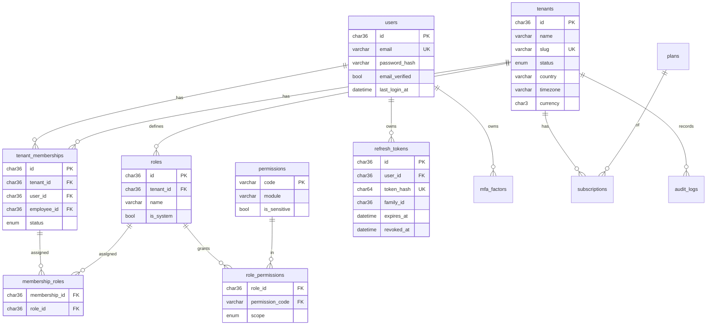
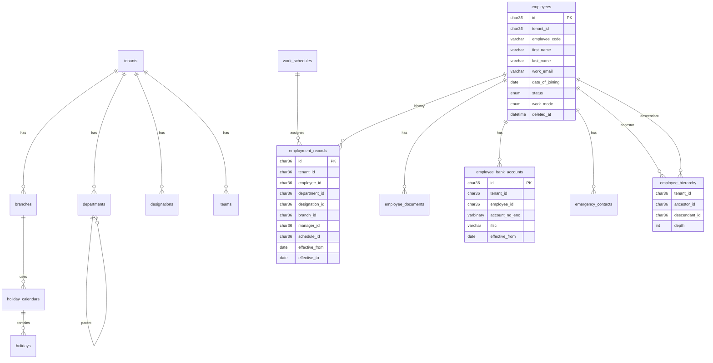
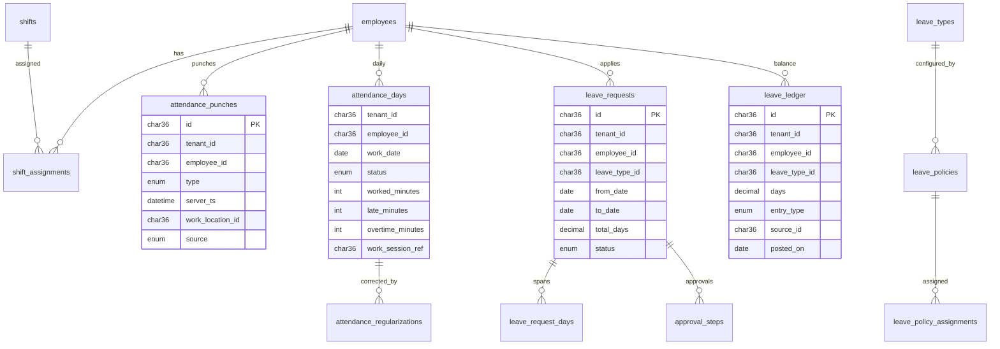
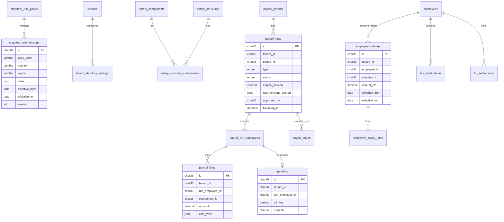
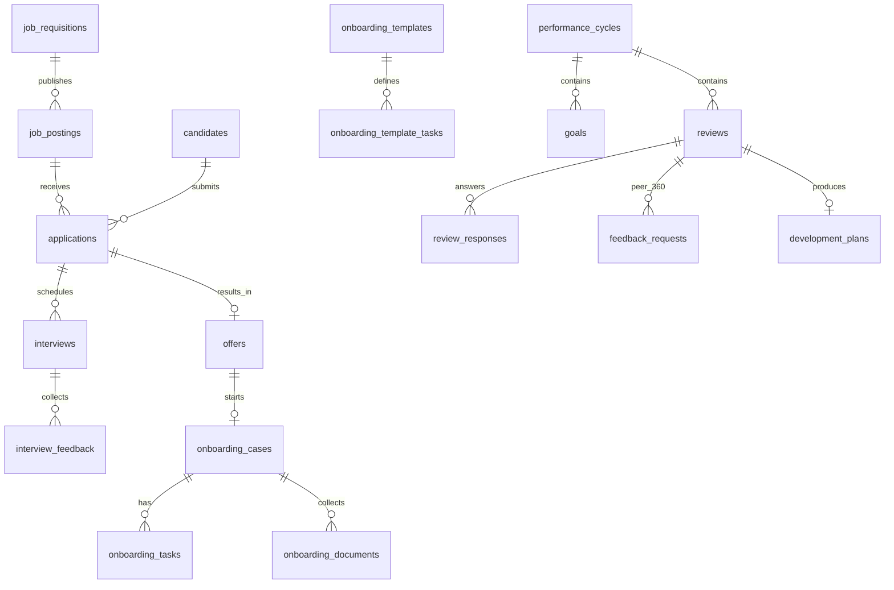
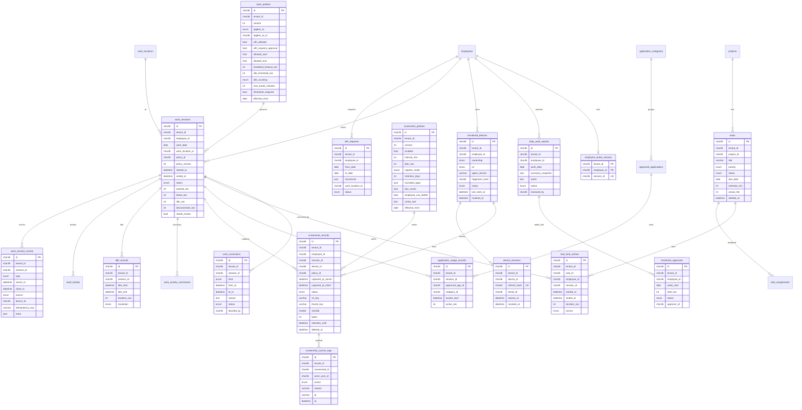

# 03 — Database Design & ER Diagrams (MySQL 8.4 + Prisma)

> **Scope update:** global tables (legal entities, country profiles, jurisdiction policies, currencies, FX rates, translations, data-subject requests) are listed in [06 §5](06-global-architecture.md#5-data-model-additions-to-03).

## 1. Conventions

| Topic | Rule |
|---|---|
| Primary keys | UUIDv7 as `CHAR(36)` (`ascii_bin`), generated in app — time-ordered (good index locality), non-enumerable |
| Tenant scope | Every tenant-owned table: `tenant_id CHAR(36) NOT NULL`, `UNIQUE(tenant_id, id)`, composite FKs `(tenant_id, x_id)` |
| Timestamps | `DATETIME(3)` in **UTC**; `created_at`, `updated_at`; business dates (`work_date`, `leave_date`) as `DATE` computed in the tenant/employee timezone |
| Money | `DECIMAL(19,4)` plus `currency CHAR(3)` (ISO 4217); rounding per currency minor units; rates/percentages `DECIMAL(9,6)`; FX `DECIMAL(19,10)`; quantities of days `DECIMAL(6,2)` |
| Soft delete | `deleted_at` on master data (employees, departments, projects, tasks). **Not** on ledgers, events, payroll, audit (append-only) |
| Effective dating | `effective_from DATE NOT NULL`, `effective_to DATE NULL`; no overlaps enforced in service layer inside a transaction with `SELECT … FOR UPDATE` on the parent |
| Versioning | Policies and rule packs: immutable versions (`version INT`), new row per change |
| Immutability | Finalized payroll, audit logs, session events: DB triggers reject `UPDATE/DELETE` (added via custom SQL in Prisma migrations) |
| Enums | Prisma enums → MySQL `ENUM`; tenant-configurable lists are tables |
| Charset | `utf8mb4`, `utf8mb4_0900_ai_ci` |
| Naming | snake_case tables/columns via Prisma `@@map`/`@map`; camelCase in JS |

Things Prisma cannot express (triggers, CHECK constraints, generated columns) live in hand-written SQL inside migration folders and are covered by migration tests.

---

## 2. Domain ER diagrams

### 2.1 Identity, tenancy & RBAC

### 2.2 Organization & employees

`employee_hierarchy` is a closure table rebuilt transactionally on manager change; it powers "team" scope queries (`WHERE ancestor_id = :me`).

### 2.3 Attendance, shifts & leave

`approval_steps` is a generic table (`entity_type`, `entity_id`, `step_no`, `approver_id`, `status`) reused by leave, WFH, attendance corrections, timesheets, requisitions and work reports. `UNIQUE(tenant_id, employee_id, work_date)` on `attendance_days`.

### 2.4 Payroll

- `rule_versions_pinned` stores exactly which statutory and tenant rule versions a run used → re-calculation is reproducible.
- `calc_trace` stores the formula inputs and intermediate values for every line (explainability).
- Trigger: once `payroll_runs.status IN ('FINALIZED','PAID')`, child rows reject `UPDATE/DELETE`; the run row allows only `FINALIZED → PAID`.

### 2.5 Recruitment, onboarding & performance (abridged)

### 2.6 Work Status, WFH & monitoring (all 22 required tables)

Additional supporting tables: `monitoring_activations` (activation checklist versions), `monitoring_acknowledgements` (employee × policy version), `screenshot_disputes`, `privacy_incidents`, `task_comments`, `task_attachments`, `project_members`.

---

## 3. Key constraints & indexes (WFH module)

| Table | Constraint / index | Purpose |
|---|---|---|
| `employee_active_session` | PK `(tenant_id, employee_id)` | One active session per employee (row-locked on start/end) |
| `work_sessions` | `IDX (tenant_id, employee_id, work_date)`, `IDX (tenant_id, status, work_date)` | Self view; live dashboard |
| `work_session_events` | `IDX (tenant_id, session_id, server_ts)`, `UNIQUE (tenant_id, device_id, idempotency_key)` | Ordered replay; dedupe retries from agent |
| `screenshot_records` | `IDX (tenant_id, employee_id, captured_at_server)`, `IDX (tenant_id, retention_until, status)` | Timeline; retention sweep |
| `screenshot_access_logs` | `IDX (tenant_id, screenshot_id, at)`, `IDX (tenant_id, actor_user_id, at)` | Audit queries |
| `daily_work_reports` | `UNIQUE (tenant_id, employee_id, work_date)` | One report per day |
| `timesheet_approvals` | `UNIQUE (tenant_id, employee_id, week_start)` | One timesheet per week |
| `application_usage_records` | `UNIQUE (tenant_id, session_id, approved_app_id, bucket_start)` | Idempotent upserts of buckets |
| `monitored_devices` | `UNIQUE (tenant_id, fingerprint_hash)` | Prevent duplicate registration |

## 4. Data volume estimate (design point: 50k employees)

| Table | Rows/day | 1-year rows | Strategy |
|---|---|---|---|
| work_session_events | ~1.2 M | ~300 M | Monthly RANGE partitioning on `server_ts` (raw SQL), archive >13 months to S3 (Parquet) |
| screenshot_records | ~720 k (15k agents, 10 min, 8 h) | metadata only | Tombstones after retention; partition monthly |
| application_usage_records | ~1.4 M (5-min buckets) | | Retention 90 days default, then rolled into `work_activity_summaries` |
| audit_logs | ~500 k | | Partition monthly; export to S3 Object Lock |

Partitioned tables in MySQL cannot have foreign keys; for these, referential integrity is enforced in the service layer and verified by a nightly consistency job (documented exception).

## 5. Retention matrix (defaults; tenant-configurable within limits)

| Data | Default | Min–Max | Deletion |
|---|---|---|---|
| Screenshots (images) | 30 days | 7–90 | Worker + S3 lifecycle tag |
| Screenshot metadata/tombstones | 1 year | — | Partition drop |
| App usage buckets | 90 days | 30–180 | Rolled up then deleted |
| Idle/session events | 13 months | — | Archive then drop partition |
| Payroll, payslips | 8 years (statutory books) | fixed | Legal hold only |
| Candidate data (not hired) | 12 months | 3–24 | Anonymize |
| Exited employee data | per policy (default 8 years for payroll-linked, 3 years for others) | | Anonymize non-statutory fields |
| Exports | 7 days | — | S3 lifecycle |
