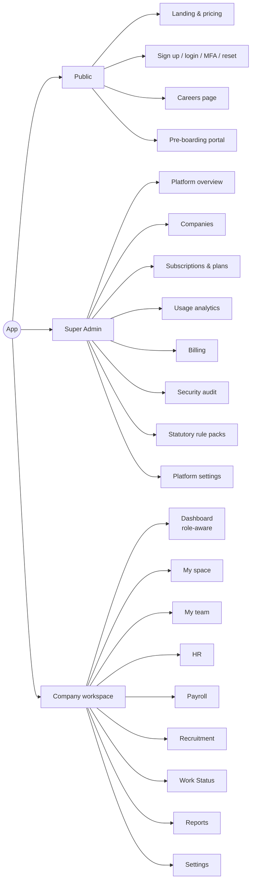

# 04 — API Specification & UI/UX Sitemap

## 1. API conventions

| Topic | Convention |
|---|---|
| Base | `/api/v1/…`, JSON, OpenAPI 3.1 at `/api/docs` (UI) and `/api/docs/openapi.json` |
| Auth | `Authorization: Bearer <access JWT>`; desktop tokens have `aud=desktop-agent` and can call only `/devices`, `/work-sessions` (own), `/screenshots/slots|confirm`, `/activity/buckets`, `/work-status/policy` |
| Tenant | Derived from token + membership; **never** from request |
| Pagination | Cursor: `?limit=50&cursor=<opaque>` → `{ data, nextCursor }`; max limit 200 |
| Filtering/sorting | `?filter[status]=ACTIVE&sort=-createdAt` with per-endpoint allowlists |
| Errors | `application/problem+json`: `{ type, title, status, code, detail, errors[], requestId }` |
| Idempotency | `Idempotency-Key` header required on: session start/end/events, payroll run actions, payments, imports. Stored 24 h in Redis + DB unique key where relevant |
| Concurrency | `ETag` / `If-Match` on mutable config (policies, salary structures) → `412` on conflict |
| Time | ISO-8601 UTC in payloads; `date` fields as `YYYY-MM-DD` in tenant timezone |
| Money | `{ "amount": "12500.00", "currency": "EUR" }` — amount as string, never a JSON number |
| Region | Each regional cell has its own API host (e.g., `eu.api.example.com`); the global login router returns the tenant's home cell. Same API in every cell |
| Locale | `Accept-Language` picks the language for server-rendered text (emails, PDFs, error `title`); data stays locale-neutral (ISO dates, codes) |
| Rate limits | Auth: 10/min/IP + 5/min/account; general: 300/min/user; heartbeat: 2/min/device; screenshot slots: policy interval-based |
| Not-found vs forbidden | Cross-tenant or out-of-scope objects return `404` (no existence leak) |

## 2. Endpoint catalogue

Notation: `perm` = required permission (scope resolved server-side). Only key endpoints listed; CRUD for config entities follows the same pattern (`GET list`, `POST`, `GET :id`, `PATCH :id`, `DELETE :id`).

### Auth — `/api/v1/auth`
| Method | Path | Notes |
|---|---|---|
| POST | `/register` | Creates user + tenant + Company Admin membership (transaction); sends verification |
| POST | `/verify-email` | token |
| POST | `/login` | → access token + refresh cookie; `mfaRequired` challenge if enabled |
| POST | `/mfa/verify` | TOTP / recovery code |
| POST | `/refresh` | Rotates refresh token (cookie + CSRF header) |
| POST | `/logout` · `/logout-all` | Revoke family / all |
| POST | `/forgot-password` · `/reset-password` | Uniform responses |
| GET | `/me` | User, memberships, effective permissions for selected tenant |
| POST | `/switch-tenant` | New access token for another membership |
| GET/DELETE | `/sessions`, `/sessions/:id` | Manage own sessions |
| POST | `/mfa/setup` · `/mfa/disable` | |

### Tenants & companies — `/tenants`, `/companies`
`GET/PATCH /companies/current` · CRUD `/companies/branches`, `/companies/departments`, `/companies/designations`, `/companies/teams`, `/companies/holiday-calendars`, `/companies/work-schedules`, `/companies/policies` · `GET /companies/org-chart` · CRUD `/tenants/roles` (`perm: roles.manage`) · `GET /tenants/permissions` · `PUT /tenants/members/:id/roles` · `POST /tenants/invitations`.

### Employees — `/employees`
| Method | Path | perm |
|---|---|---|
| GET | `/` (directory, filters) | `employee.profile.view` |
| POST | `/` | `employee.profile.create` |
| GET/PATCH | `/:id` | view/update (field-level masking by perm) |
| GET/POST | `/:id/employment-records` | effective-dated changes (transfer, promotion, manager change) |
| GET/POST | `/:id/documents` · `POST /:id/documents/upload-url` | `employee.documents.*` |
| GET/PUT | `/:id/bank-accounts` | `payroll.bank.view` / `payroll.bank.manage` |
| POST | `/imports` · `GET /imports/:jobId` | `employee.bulk.import` |
| POST | `/exports` | `reports.export` |
| POST | `/:id/exit` | Starts exit + F&F |

### Attendance — `/attendance`
`POST /punches` (clock-in/out) · `GET /me?from&to` · `GET /team` · `GET /days` · `POST /regularizations` · `POST /regularizations/:id/decision` · CRUD `/shifts`, `/shift-assignments`, `/overtime-rules` · `GET /reports/:type`.

### Leaves — `/leaves`
CRUD `/types`, `/policies`, `/policy-assignments` · `GET /balances/me` · `GET /ledger/:employeeId` · `POST /requests` · `GET /requests?scope=me|team` · `POST /requests/:id/decision` · `POST /requests/:id/cancel` · `POST /encashments` · `POST /accruals/run` (admin, idempotent per period).

### Payroll — `/payroll`
| Method | Path | perm |
|---|---|---|
| CRUD | `/components`, `/structures` | `payroll.config.manage` |
| GET/POST | `/statutory-settings` (tenant overrides, effective-dated) | `payroll.config.manage` |
| GET/POST | `/employees/:id/salaries` | `payroll.salary.view/manage` |
| POST | `/runs` | `payroll.run.create` |
| POST | `/runs/:id/lock-inputs` · `/calculate` · `/review` · `/approve` · `/finalize` · `/mark-paid` | step-specific perms; approve requires different user than reviewer |
| GET | `/runs/:id`, `/runs/:id/employees`, `/runs/:id/variance` | |
| POST | `/runs/:id/inputs` | variable pay, arrears, adjustments (pre-lock) |
| GET | `/runs/:id/bank-file` | signed URL; audited |
| GET | `/payslips/me` · `/payslips/:id/download-url` | own / `payroll.payslip.view` |
| CRUD | `/tax-declarations` | self + `payroll.tax.review` |

### Recruitment — `/recruitment`
`/requisitions` (+ `/decision`) · `/postings` · `/candidates` (+ `/resume-upload-url`, `/parse`) · `/applications` (+ `/move-stage`) · `/interviews` (+ `/feedback`) · `/offers` (+ `/send`, `/accept`, `/decline`) · public `GET /public/careers/:tenantSlug/jobs`, `POST /public/careers/:tenantSlug/jobs/:id/apply` (captcha, rate-limited).

### Onboarding — `/onboarding`
`/templates` · `/cases` · `/cases/:id/tasks` · `/cases/:id/documents` (+ `/verify`) · `/portal/me` (pre-boarding user).

### Performance — `/performance`
`/cycles` · `/goals` · `/reviews` (+ `/self`, `/manager`, `/submit`) · `/feedback-requests` · `/calibration/:cycleId` · `/development-plans`.

### Work status — `/work-status`
| Method | Path | perm |
|---|---|---|
| CRUD | `/locations` | `work.config.manage` |
| CRUD | `/policies` (versioned) | `work.config.manage` |
| GET | `/policy/effective` (me) | self |
| CRUD | `/wfh-requests` (+ `/decision`) | self / approver |
| GET | `/live?department&team` | `view_team_work_status` |
| GET | `/hr-dashboard` | `view_activity_reports` |
| GET/POST | `/monitoring/activations` | `manage_monitoring_policy` |
| POST | `/monitoring/acknowledgements` | self |

### Work sessions — `/work-sessions`
| Method | Path | Notes |
|---|---|---|
| POST | `/` | Start (location, ack of policy version). 409 if active session exists → returns it |
| GET | `/current` | Server-computed totals + state |
| POST | `/:id/events` | `BREAK_START`, `BREAK_END`, `IDLE_START/END` (agent), `END`; Idempotency-Key required |
| POST | `/:id/heartbeat` | Lightweight; updates presence; returns `{ state, serverTime, policyVersion }` |
| GET | `/?from&to&employeeId` | Self or `manage_work_sessions` / `view_team_work_status` |
| POST | `/:id/corrections` · `POST /corrections/:id/decision` | Request / approve (`manage_work_sessions`) |
| GET | `/daily-reports/me?date` · `PATCH /daily-reports/:id` · `POST /daily-reports/:id/submit` · `POST /daily-reports/:id/decision` | `approve_work_reports` |

### Screenshots — `/screenshots`
| Method | Path | perm |
|---|---|---|
| POST | `/slots` | desktop token; active session; policy |
| POST | `/:id/confirm` | desktop token |
| POST | `/skips` | desktop token (reason codes only) |
| GET | `/?employeeId&sessionId&date` | `view_own_screenshots` / `view_team_screenshots` |
| GET | `/:id/view-url` | same; logs `VIEW` |
| POST | `/:id/download` | `download_screenshots`; logs `DOWNLOAD`; watermarked |
| DELETE | `/:id` | owner (if policy allows) / privacy officer; logs `DELETE` with reason |
| POST | `/:id/disputes` · `POST /disputes/:id/resolve` | self / `manage_monitoring_policy` |
| POST | `/privacy-incidents` | self |
| GET | `/access-logs?screenshotId|actorId` | `audit.log.view` |
| CRUD | `/policies` (versioned) | `manage_monitoring_policy` |

### Devices — `/devices`
`POST /pairing-codes` (web, self) · `POST /register` (agent, with code) · `POST /token/refresh` (agent) · `GET /me` · `GET /` (`manage_monitoring_policy`) · `POST /:id/approve` · `POST /:id/revoke` · `GET /agent/latest-version`.

### Activity — `/activity`
`POST /buckets` (agent; aggregated) · CRUD `/categories`, `/approved-applications` · `GET /reports?employeeId&from&to` (`view_activity_reports`).

### Tasks & projects — `/tasks`, `/projects`
`/projects` (+ `/members`) · `/tasks` (filters: assignee, status, project, due) · `PATCH /tasks/:id/status` (state machine validated) · `/tasks/:id/comments` · `/tasks/:id/attachments/upload-url` · `/tasks/:id/time-entries` (start/stop timer tied to active session) · `POST /tasks/:id/approve`.

### Timesheets — `/timesheets`
`GET /me?week` · `POST /:id/submit` · `GET /team?week` · `POST /:id/decision` (`approve_timesheets`).

### Reports — `/reports`
`GET /catalog` · `POST /runs` (async) · `GET /runs/:id` (status + signed URL) · dashboards: `/dashboards/hr`, `/dashboards/attendance`, `/dashboards/payroll`, `/dashboards/remote-work`.

### Subscriptions — `/subscriptions`
`GET /plans` (public) · `GET /current` · `POST /checkout` · `POST /change-plan` · `GET /invoices` · `POST /webhooks/:provider` (signature verified, idempotent).

### Platform (Super Admin) — `/platform`
`/tenants` (list, suspend, reactivate) · `/plans` · `/usage` · `/billing` · `/security-events` · `/break-glass` (request, approve, expire) · `/statutory-rule-packs` (publish new versions) · `/settings`.

### System
`GET /health/live` · `GET /health/ready` (DB, Redis) · `GET /metrics` (internal only).

---

## 3. UI/UX sitemap

Design tokens: Primary `#2563EB`, Secondary `#0F172A`, Background `#F8FAFC`, Surface `#FFFFFF`, Success `#16A34A`, Warning `#F59E0B`, Danger `#DC2626`, Border `#E2E8F0`. Inter font; 4-px spacing grid; dark mode later. Every list/detail page has loading (skeleton), empty, error (retry), and success (toast) states. Navigation is permission-driven: menu items are hidden when the user lacks the permission, and the backend enforces it regardless.



| Area | Screens |
|---|---|
| **My space** (Employee) | Dashboard · Profile · Attendance check-in & history · Leave apply/balances · Payslips & tax declarations · Documents · Announcements · Helpdesk · Performance (goals, reviews) · **Work Status**: WFH check-in, live work timer, break controls, task list, daily report, my screenshots, monitoring status & policy, my devices, corrections & disputes |
| **My team** (Manager/TL) | Team dashboard · Availability & WFH status (live) · Approvals inbox (leave, WFH, corrections, reports, timesheets) · Task assignment & team progress · Work reports · Timesheet approvals · Authorized screenshot review (only with permission) · Team attendance · Reviews |
| **HR** | Employees (directory, profile, documents, import) · Org (branches, departments, designations, org chart) · Attendance & shifts · Leave config & reports · Onboarding cases & templates · Performance cycles · Exits · Announcements · Policies |
| **Payroll** | Runs (stepper through lifecycle) · Variance review · Salary structures/components · Employee salaries · Statutory settings · Tax declarations review · Bank files · F&F |
| **Recruitment** | Requisitions · Jobs · Pipeline (kanban) · Candidates · Interviews calendar · Offers · Analytics |
| **Work Status (admin)** | Live board · HR remote-work dashboard · Work locations · Work policies · Monitoring activation checklist · Screenshot policies · Devices · Approved apps & categories · Disputes & privacy incidents · Access logs |
| **Reports** | Catalogue · Scheduled reports · Exports history |
| **Settings** | Company profile · Roles & permissions (matrix with sensitive groups flagged) · Users & invitations · Notifications & templates · Integrations · Billing & subscription · Security (MFA enforcement, sessions) · Audit log |

### 3.1 Work Status dashboard (employee) — layout

```
┌───────────────────────────────────────────────────────────────────────────┐
│ [WFH ●] Work session · Active      08:42:17   [Take break] [End session]  │
│ Monitoring: ON (desktop agent, every 10 min) · Last capture 10:20 · Policy│
├───────────────────────────────┬───────────────────────────────────────────┤
│ Today                         │ My tasks                    [+ Log time]  │
│  Worked 05:12  Break 00:35    │  ▶ API: leave ledger   In progress  1h20  │
│  Idle 00:08   Disconnected 0  │  ○ Fix payslip PDF     Assigned     0h00  │
│  First in 09:02 (server)      │  ✓ Review PR #42       Completed    0h45  │
├───────────────────────────────┴───────────────────────────────────────────┤
│ Timeline  09 ──■■■■■■■■□□■■■■■■■■■■■■■■░░■■■■── now                       │
│           ■ working  □ break  ░ idle  ▲ screenshot (click → my screenshots)│
├───────────────────────────────────────────────────────────────────────────┤
│ Daily report: auto-summary + notes [Submit]   · Status: Draft             │
└───────────────────────────────────────────────────────────────────────────┘
```
The timer display is cosmetic; it re-syncs to `serverTime` + server totals from every heartbeat response.
