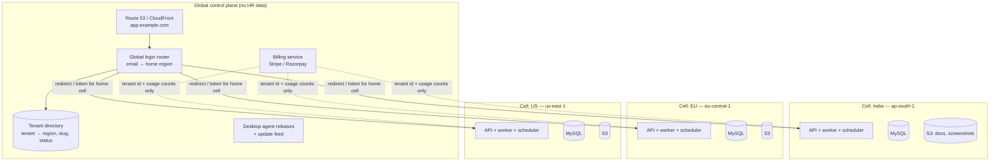
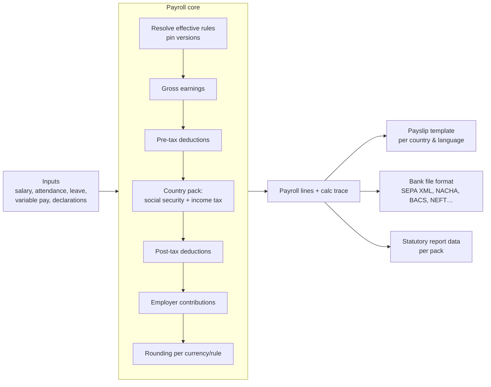

# 06 — Global (Worldwide) Product Architecture

Status: **Draft for review** · Supersedes every "India-first" assumption in documents 01–05. Where they conflict, this document wins.

---

## 1. What changes when the product is worldwide

| Area | India-only plan | Worldwide plan |
|---|---|---|
| Tenants | Indian companies | Companies in any country, often with employees in **several** countries |
| Data hosting | One AWS region (Mumbai) | **Regional deployment "cells"** (data residency per tenant) |
| Payroll | India rule pack | **Country-pluggable payroll engine**: native packs for selected countries, plus a generic configurable engine and export/partner integrations for the rest |
| Privacy law | DPDP Act | Many laws per jurisdiction (GDPR/UK GDPR, CCPA/CPRA, DPDP, LGPD, PIPEDA, PDPA, POPIA, APPs, PIPL and more). Monitoring rules differ by country |
| Leave & attendance | Indian norms | Country-specific statutory leave, public holidays, working-time limits (e.g., EU Working Time Directive), overtime rules |
| Language & formats | English | i18n: UI strings, locale formats, RTL scripts, multiple currencies, time zones, local name/address formats |
| Billing | INR, GST | Multi-currency pricing, VAT/GST/sales tax, global payment gateway |
| Documents | Indian IDs (PAN, Aadhaar) | Configurable national ID types per country (SSN, NI number, SIN, TFN, CPF, PAN…) with per-type validation and encryption |

---

## 2. Global requirements (added)

### 2.1 Organization & employees
- GLB-01 A tenant has one or more **legal entities**. Each entity has its own country, currency, registration/tax IDs, payroll calendar and statutory settings. Branches belong to legal entities.
- GLB-02 Each employee has: **country of employment** (from the legal entity), work location country (can differ for remote workers), nationality, locale, timezone and pay currency.
- GLB-03 Personal-data fields come from **country profiles** (configuration, not code): national ID types, tax ID format, bank fields (IBAN/SWIFT, ABA routing, IFSC, sort code, BSB…), address format, name order, and which fields are mandatory or prohibited.
- GLB-04 Fields that are sensitive or legally restricted in some countries (religion, ethnicity, marital status, date of birth for hiring, photos) are **disabled by default** and can only be enabled per country profile.

### 2.2 Attendance, leave & work time
- GLB-05 Public holidays per country/region (seeded from a maintained dataset, editable per tenant).
- GLB-06 Statutory leave templates per country (minimum annual leave, sick leave, parental leave), effective-dated and versioned like payroll rules.
- GLB-07 Working-time rules per jurisdiction: max weekly hours, daily rest, breaks, overtime thresholds and multipliers. Breaches are flagged to HR; the system never blocks an employee from recording actual time worked.
- GLB-08 Week start, weekend days (e.g., Fri–Sat) and fiscal year are configurable per legal entity.

### 2.3 Payroll
- GLB-09 **Payroll engine core** (country-neutral): gross-to-net pipeline of ordered calculation steps, using components, formulas, brackets/slabs, caps, rounding rules and employer contributions. All rules are effective-dated, versioned data.
- GLB-10 **Country packs** are plugins. Each pack supplies a JS calculation module, its rule data, statutory reports/filings formats, payslip template fields and validation tests. Packs are versioned and published by the platform. Tenants can override only where the pack allows it.
- GLB-11 Three payroll coverage levels per country:
  | Level | Meaning | Example use |
  |---|---|---|
  | **Native** | Full statutory calculation, payslips, filings data | Launch countries (to be chosen) |
  | **Configurable** | Generic engine; tenant or partner defines rules; platform makes no compliance claim | Countries without a pack |
  | **Export / integrate** | HR, attendance and leave data sent to a local payroll provider or EOR (Employer of Record) via export file or API | Complex or small-volume countries |
- GLB-12 Multi-currency: each payroll run is in one legal-entity currency. Reports can convert to a reporting currency using **dated FX rates** stored with the source and rate date. No silent re-conversion of finalized amounts.
- GLB-13 Currency precision follows ISO 4217 minor units (e.g., JPY 0, USD 2, KWD 3). Storage is `DECIMAL(19,4)`; rounding per currency and per component rule.

### 2.4 Monitoring & privacy (jurisdiction-aware)
- GLB-14 A **jurisdiction policy registry** (configuration maintained by the platform with legal review) describes, per country/state, what the product allows for monitoring. For example:
  - whether screenshot monitoring may be enabled at all, or only with extra steps,
  - mandatory notice content and timing (e.g., written notice before monitoring starts),
  - whether a DPIA (data protection impact assessment) or works council/employee-representative approval must be recorded first,
  - maximum retention, and whether app-activity metadata is permitted.
- GLB-15 The **monitoring activation checklist** becomes jurisdiction-aware. It adds the steps each employee's work country requires. Monitoring applies per employee only when the steps for **their** jurisdiction are complete.
- GLB-16 Where the registry says "not permitted" or "unknown", screenshot features stay **off** for those employees (fail closed). Session tracking, tasks and daily reports stay available.
- GLB-17 Data-subject rights for all regimes: access, export (machine-readable), correction, deletion/anonymization, objection, with request tracking and deadlines per regime.
- GLB-18 Records of processing, sub-processor list, DPA (data processing agreement) and Standard Contractual Clauses are available to tenants. Cross-region data transfer is **off** unless a tenant explicitly enables it.

### 2.5 Localization
- GLB-19 UI fully externalized into translation files (ICU message format). Launch languages to be chosen; English is the base.
- GLB-20 All dates, numbers and currencies formatted with `Intl` APIs using the user's locale. Storage remains UTC and ISO formats.
- GLB-21 RTL layout support (Arabic, Hebrew) built in from the start, using Tailwind logical properties (`ms-*`, `me-*`, `start-*`).
- GLB-22 Emails, payslips, offer letters and policy notices are templated per language. The employee monitoring notice is shown in the employee's language, and the version they acknowledged is recorded with its language.

### 2.6 Billing
- GLB-23 Prices per plan in several currencies (USD, EUR, GBP, INR at launch; extensible).
- GLB-24 Tax on invoices by customer location (VAT/GST/sales tax) through the payment provider's tax service, with reverse-charge handling for B2B in the EU.
- GLB-25 Payment gateway: **Stripe** as the global default; **Razorpay** as an India option (UPI, local cards, RBI e-mandate rules).

---

## 3. Regional cell architecture (data residency)



Rules:
1. **A tenant lives in exactly one cell**, chosen at sign-up (default suggested from the company's country). All HR data, screenshots, documents, logs and backups for that tenant stay in that cell's region and its paired DR region **inside the same jurisdiction** (e.g., EU Frankfurt → EU Ireland).
2. Each cell is the **same codebase and same Terraform module** with different variables. Cells share nothing at the data layer.
3. The **global control plane** holds only: tenant directory (id, name, slug, region, status), login routing (hashed email → region), plan/billing records and agent releases. No employee data.
4. A login first hits the global router, which sends the user to their home cell. The cell issues the tokens. Each cell has its own signing keys. Tokens from one cell are rejected by the others.
5. The desktop agent receives its cell's API base URL at pairing and only talks to that cell.
6. Moving a tenant between cells is an offline, audited migration job (export → import → verify → cut-over → delete source), offered only on request.
7. Initial cells: **to be decided by you** (suggested: India, EU, US). A new cell can be added later without code changes.
8. A tenant whose employees are in many countries still has one cell. The tenant chooses it, and the DPA records the transfer basis for employees outside that region.

### Changes to the multi-tenant design (02 §3)
- All five tenant-isolation layers stay. Cells add a sixth layer: **regional isolation**. One tenant's data cannot be reached from another region's infrastructure, even by a bug.
- The `users` table moves from "global" to **per cell**. A person who belongs to tenants in two different cells has two separate accounts (rare for SME customers; the login router handles it by asking which company).

---

## 4. Payroll engine design (country-pluggable)



Country pack contract (JavaScript, `packages/payroll-packs/<countryCode>/`):

```js
/**
 * @typedef {Object} CountryPack
 * @property {string} code            ISO 3166-1 alpha-2, e.g. "IN", "GB"
 * @property {string} version         semver; pinned per payroll run
 * @property {(ctx: PackContext) => PackResult} calculate   pure function, decimal.js only
 * @property {import('zod').ZodSchema} employeeFieldsSchema  country-specific employee fields
 * @property {import('zod').ZodSchema} rulesSchema          shape of the effective-dated rule data
 * @property {string[]} bankFileFormats
 * @property {string[]} reports
 */
```

- Packs are pure functions with no I/O, so they are easy to unit-test with golden files.
- Rule **data** (rates, slabs, caps) lives in the database, effective-dated. Pack **code** only says how to apply it. That keeps "no hardcoded statutory rates" true in every country.
- Each pack ships with golden-file tests reviewed by an in-country payroll expert before it can be marked "Native".

---

## 5. Data model additions (to 03)

| Table | Purpose |
|---|---|
| `legal_entities` | Tenant's employing companies per country: country, currency, tax/registration IDs, fiscal year, week config |
| `country_profiles` (global, platform-maintained) | Field rules, ID types, bank field formats, address format, name order, restricted fields |
| `jurisdiction_policies` (global, versioned) | Monitoring permissions and required steps per country/state; retention limits; legal review date |
| `monitoring_jurisdiction_steps` | Per tenant × jurisdiction: completed DPIA, works-council approval, notice records |
| `statutory_rule_packs` / `statutory_rule_versions` | Now keyed by `country_code` (+ optional `region_code`) |
| `public_holiday_sets` | Country/region holiday datasets by year |
| `currencies` (ISO 4217, minor units) and `fx_rates` (`base`, `quote`, `rate DECIMAL(19,10)`, `rate_date`, `source`) | Multi-currency |
| `translations` / `message_templates` | Per-language email, document and notice templates |
| `data_subject_requests` | Requests per privacy regime, with deadlines and status |
| `tenant_directory` (control plane only) | `tenant_id`, `slug`, `region`, `status` |

Column changes:
- Money columns move from `DECIMAL(15,2)` to **`DECIMAL(19,4)`** with a `currency CHAR(3)` column next to every amount (or one at row level for single-currency rows).
- `employees` gains `legal_entity_id`, `work_country`, `locale`, `timezone`, `pay_currency`.
- Country-specific employee fields go in validated JSON (`country_fields`) checked against the pack's `employeeFieldsSchema`, plus encrypted columns for national IDs.

---

## 6. Stack additions

| Need | Choice (JavaScript) |
|---|---|
| UI translations | `i18next` + `react-i18next`, ICU messages; translation files in `packages/shared/locales/` |
| Formatting | Native `Intl` (DateTimeFormat, NumberFormat, PluralRules, RelativeTimeFormat) |
| Time zones | Temporal API where available, otherwise `@js-temporal/polyfill`; all business-day calculations in the employee's IANA time zone |
| Phone / address | `libphonenumber-js`; address formats from country profiles |
| Bank validation | `ibantools` (IBAN/BIC); per-country validators in packs |
| Payments & tax | Stripe (Billing + Stripe Tax); Razorpay for India |
| Holidays | `date-holidays` dataset as seed, editable per tenant |
| RTL | Tailwind logical properties; `dir` attribute set from locale |

---

## 7. Roadmap impact

| Change | Where |
|---|---|
| i18n framework, locale formatting and RTL-safe components built in from Sprint 1 (much cheaper than retrofitting) | Sprint 1 |
| Legal entities, country profiles, multi-currency columns | Sprint 3–4 |
| Country-specific holidays, leave templates, working-time rules | Sprint 5–6 |
| Payroll core + **first native pack(s)** (countries to be chosen) + generic configurable mode + payroll export | Sprint 7 (+1 sprint per extra native pack) |
| Jurisdiction registry + jurisdiction-aware activation checklist | Sprint 10 (with desktop agent) |
| Stripe multi-currency billing + tax | Sprint 11 |
| Second and third regional cells, login router, cell-aware agent pairing | Sprint 12 (first cell from day 1; extra cells before GA) |
| Data-subject request workflows | Sprint 12 |

Net effect: about **+3 sprints** before MVP (roughly week 34 instead of 28), assuming two native payroll countries at launch. Each additional native payroll country costs about one sprint plus an external expert review.

---

## 8. New risks

| ID | Risk | L | I | Mitigation |
|---|---|---|---|---|
| R14 | **Worldwide payroll compliance is not achievable at launch** — every country has unique, frequently changing rules | H | H | Three coverage levels (Native / Configurable / Export). Only claim compliance for Native packs reviewed by in-country experts. Partner/EOR integrations for the rest |
| R15 | Monitoring is legally restricted or needs extra approvals in some countries (e.g., EU works councils, notice laws in some US states) | H | H | Jurisdiction registry with legal review; fail-closed for unknown jurisdictions; per-employee enforcement |
| R16 | Cross-border data transfers for multinational tenants | M | H | Regional cells, transfers off by default, SCCs/DPA, documented transfer basis |
| R17 | Operating several regional cells multiplies ops cost and on-call load | M | M | Identical Terraform module per cell, central observability, staged rollout cell by cell |
| R18 | Translation quality and legal text accuracy in many languages | M | M | Professional translation for legal/notice text; community or machine translation only for UI strings, reviewed |
| R19 | Indirect tax on SaaS sales in many countries | M | M | Stripe Tax for calculation and registration tracking; finance review per new market |
