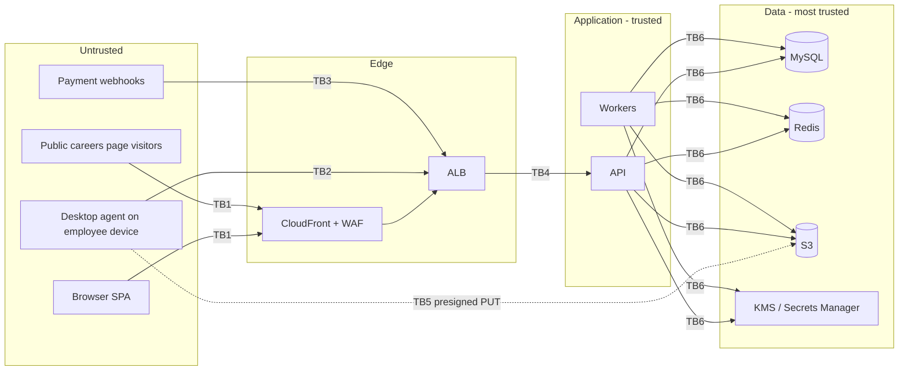

# 01 — Threat Model

Method: STRIDE per trust boundary, plus abuse cases specific to HR data and employee monitoring. Reviewed again at the end of every sprint that adds a module.

## 1. Assets (ranked by impact if exposed or altered)

| # | Asset | Classification | Why it matters |
|---|---|---|---|
| A1 | Screenshots | **Restricted** | Can contain personal or third-party data; highest privacy risk |
| A2 | Salary, payslips, bank accounts, tax IDs, national IDs | **Restricted** | Financial fraud, identity theft, legal exposure |
| A3 | Health data (sick leave reasons, medical documents), disciplinary records | **Restricted** (special category) | Special-category data under GDPR and similar laws |
| A4 | Employee profiles, contact details, documents | Confidential | Personal data |
| A5 | Work-session, idle and app-activity records | Confidential | Can be misused to profile employees |
| A6 | Credentials, refresh tokens, device tokens, MFA secrets | Secret | Account takeover |
| A7 | Encryption keys, signing keys (JWT, code signing) | Secret | Total compromise |
| A8 | Audit logs | Confidential, integrity-critical | Evidence for disputes and investigations |
| A9 | Payroll rule packs and finalized runs | Integrity-critical | Wrong pay for every employee |
| A10 | Desktop agent update channel | Integrity-critical | Malware distribution to every customer laptop |

## 2. Threat actors

| Actor | Motivation | Capability |
|---|---|---|
| External attacker | Data theft, ransomware, fraud | Credential stuffing, phishing, scanning, exploit chains |
| Malicious tenant user | Read another tenant's data | Valid account in their own tenant |
| Curious or abusive insider in a tenant (manager, HR) | Surveillance beyond their remit, salary snooping | Valid account with some permissions |
| Employee gaming the system | Inflate work time, avoid capture | Controls their own device and network |
| Compromised employee device | Steal tokens, upload fake data | Malware on endpoint |
| Vendor insider (our staff) | Curiosity, coercion | Infrastructure access |
| Supply-chain attacker | Wide compromise | Malicious npm package, CI compromise, stolen signing cert |

## 3. Trust boundaries

## 4. STRIDE analysis

| ID | Boundary / component | Threat | STRIDE | Mitigation (control IDs in 02) | Residual |
|---|---|---|---|---|---|
| T1 | TB1 login | Credential stuffing, brute force | S | AUTH-04 rate limits, AUTH-06 breached-password check, MFA (AUTH-07), lockout alerts | Low |
| T2 | TB1 session | Stolen access token via XSS | S/I | APP-03 CSP with nonces, React escaping, 15-min access token in memory only, refresh in HttpOnly cookie | Low |
| T3 | TB1 refresh | Refresh token replay | S | AUTH-09 rotation + family reuse detection | Low |
| T4 | TB1 any API | Cross-tenant read by changing IDs (IDOR) | I | TEN-01…08 tenant context, composite FKs, 404 policy, cross-tenant test suite | Low |
| T5 | TB1 any API | Privilege escalation (manager grants self screenshot permission) | E | RBAC-05 no self-grant, sensitive grants need Company Admin + audit + notification to the tenant's admins | Low |
| T6 | TB1 any API | Horizontal escalation in a tenant (manager reads another team) | I | RBAC-03 hierarchy scope check in every policy function | Medium (logic bugs) — covered by scoped tests |
| T7 | TB1 inputs | SQL injection | T/I | Prisma parameterization, raw SQL ban (APP-01), Semgrep rule | Low |
| T8 | TB1 inputs | Stored XSS via names, task comments, job posts | T/I | APP-02 output encoding, DOMPurify for rich text, CSP | Low |
| T9 | TB1 cookie endpoints | CSRF on refresh/logout | T | AUTH-10 SameSite=Strict + double-submit token + Origin check | Low |
| T10 | TB1 uploads | Malware, polyglot files, path traversal, zip bombs | T/E | FILE-01…06 presigned uploads, magic-byte checks, size limits, ClamAV, server-generated keys, no archive extraction | Low |
| T11 | TB1 reports | CSV/formula injection in exports | T | APP-06 prefix `'` for cells starting with `= + - @ \t \r` | Low |
| T12 | TB2 agent | Stolen device token used from another machine | S | DEV-03 short-lived access tokens, refresh rotation, device binding, revoke, anomaly alerts (IP/ASN change) | Medium |
| T13 | TB2 agent | Employee fakes heartbeats to inflate time | T/R | Heartbeats only maintain a session; work time needs consistent server-side events; idle reported by OS; manager review; no automated pay impact without approval | Medium (accepted, documented) |
| T14 | TB2 agent | Agent turned into a surveillance tool beyond policy (malicious admin changes interval to 1 min, removes exclusions) | E/I | MON-02 policy limits (min interval 5 min, mandatory default exclusions), every policy change versioned, notified to employees, re-acknowledgment required for expanded scope | Low |
| T15 | TB5 upload | Upload of non-image or another tenant's key | T | Server builds the key; presigned POST with exact key, content-type and size; worker verifies hash and magic bytes | Low |
| T16 | TB3 webhooks | Forged payment events | S/T | WH-01 signature verification, timestamp tolerance, idempotency on event ID | Low |
| T17 | TB4 API | DoS via expensive endpoints (reports, search) | D | Rate limits per route class, async reports, pagination caps, WAF rate rules, query timeouts | Medium |
| T18 | TB6 data | Leaked DB snapshot or backup | I | Encryption at rest (KMS), app-level envelope encryption for Restricted fields, snapshot sharing blocked by SCP | Low |
| T19 | TB6 S3 | Public bucket misconfiguration | I | Account-level Block Public Access, bucket policies deny non-TLS and non-VPC-endpoint, AWS Config rule alerts | Low |
| T20 | Audit | Insider deletes audit trail | R | DB trigger blocks UPDATE/DELETE, monthly export to S3 Object Lock (compliance mode) | Low |
| T21 | Payroll | Altering a finalized run | T/R | Immutability triggers, maker-checker, signed hash of finalized run stored separately | Low |
| T22 | Vendor insider | Staff browsing tenant data | I | No standing access; break-glass with tenant visibility, time limit, reason; all access via audited platform API | Low |
| T23 | Supply chain | Malicious npm dependency | T/E | Lockfile, `npm ci`, `--ignore-scripts` where possible, OSV/Socket scanning, minimum package age policy, SBOM | Medium |
| T24 | Release | Stolen code-signing key, poisoned update | T/E | Signing in HSM-backed service (Azure Trusted Signing / Apple notarization), CI OIDC, protected release environment with 2-person approval, update signature verification in agent | Low |
| T25 | Logs | Tokens or PII leaked into logs | I | pino redaction, log schema review, Gitleaks-like scanner on log samples in CI | Low |
| T26 | Multi-region | Data replicated outside the tenant's region | I | Cell isolation, S3 replication only to same-jurisdiction DR region, IaC policy checks | Low |

## 5. Monitoring-specific abuse cases

| Abuse case | Prevention | Detection |
|---|---|---|
| Manager views screenshots of someone outside their team | Scope check on every view-URL request; storage keys never exposed | Access log; alert if a user views > N employees/day |
| HR enables monitoring for one employee to target them | Policies apply to groups (≥ 5 people by default, configurable down with a documented reason); employee notified on every change | Policy change log visible to employees |
| Covert monitoring (no tray icon, no notice) | Agent refuses to capture without acknowledged policy version and visible tray state; not configurable by tenants | Agent self-test reports to server; integrity check |
| Bulk download of screenshots for off-platform analysis | No bulk export; per-image download needs `download_screenshots`, is watermarked and rate-limited | Download alerts |
| Using activity data as a "productivity score" for dismissal | Product has no score; reports show time and categories only; guidance in admin docs | — (policy) |
| Retention extended indefinitely | Plan-level maximum (90 days); legal hold requires a reason and auto-expires | Retention report |
| Capturing outside work hours | Server rejects slot requests outside active sessions and allowed hours | Rejected-slot metrics |

## 6. Accepted risks (owner sign-off needed)

1. **T13** — a determined employee can keep a session alive with automation. We do not try to detect this with invasive techniques (keystroke analysis). Mitigation is human review of work output.
2. **Screenshot content** — a captured screen may still show third-party or personal data despite exclusions (see Phase 1, 02 §5.5). Mitigated by disputes, privacy-incident deletion and short retention.
3. **Linux/Wayland** — no screenshot support, by design of the OS.
